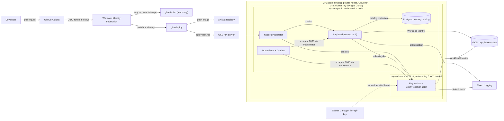
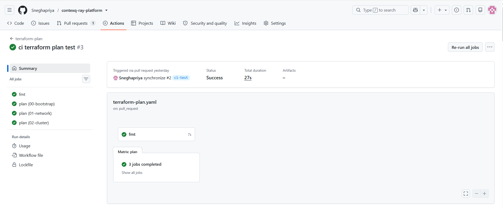
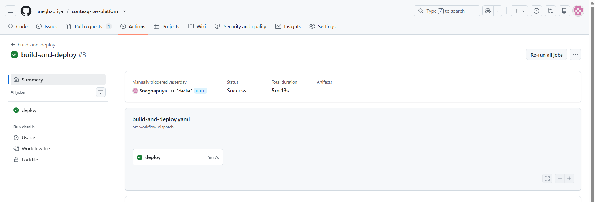
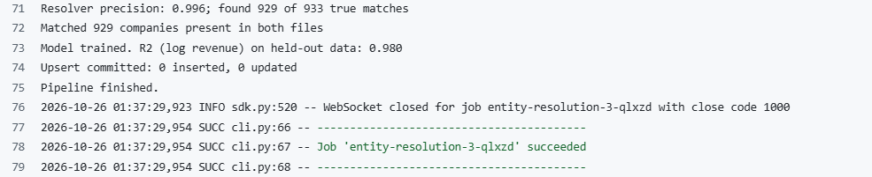
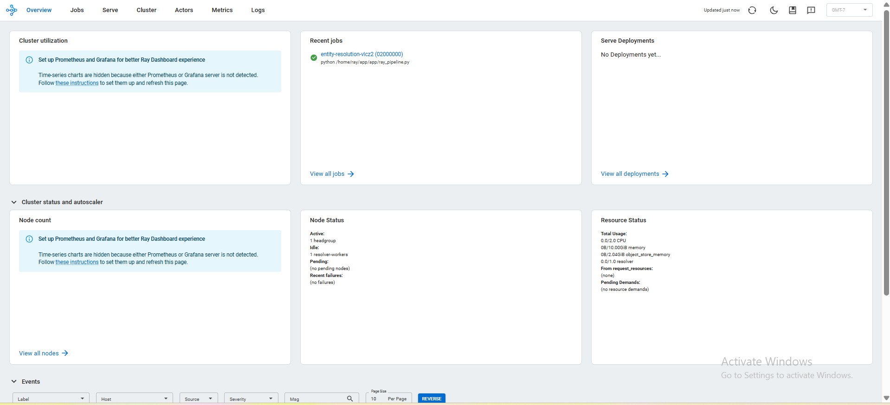
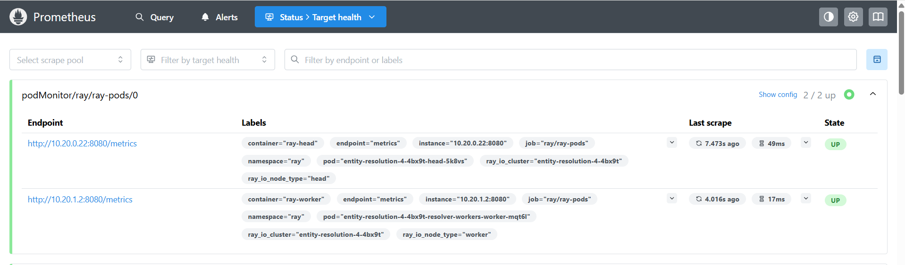
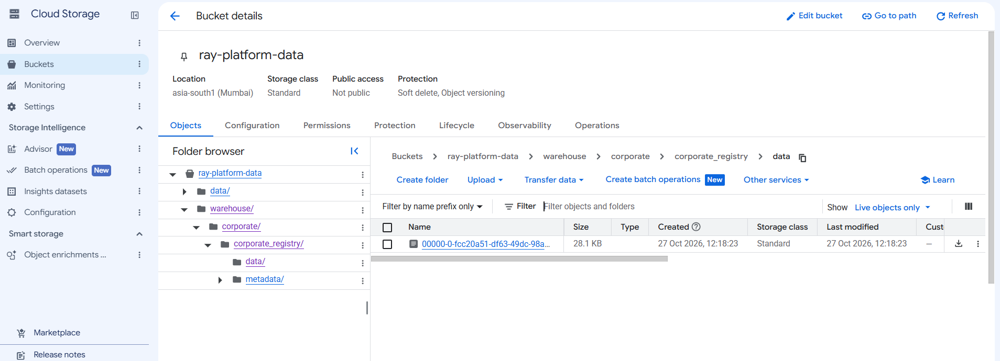

# Ray AI Platform on GKE: "The Distributed AI Foundation"

A production-like platform for running a scheduled Ray pipeline on Kubernetes (GKE). The job ingests two corporate datasets, resolves duplicate companies (entity resolution), upserts the harmonized result into an Apache Iceberg table transactionally, and trains a model that predicts annual revenue.

Everything is infrastructure as code (Terraform, in decoupled state layers), keyless (Workload Identity for pods, Workload Identity Federation for CI), and delivered through GitHub Actions.

Repository: https://github.com/Sneghapriya/contexq-ray-platform

## Contents

1. [Architecture](#1-architecture)
2. [Repository layout](#2-repository-layout)
3. [The pipeline](#3-the-pipeline)
4. [Setup and runbook](#4-setup-and-runbook)
5. [Terraform design](#5-terraform-design)
6. [Spot instance strategy](#6-spot-instance-strategy)
7. [Ray Data and Ray Train configuration](#7-ray-data-and-ray-train-configuration)
8. [Scheduling the EntityResolver](#8-scheduling-the-entityresolver)
9. [Security and zero trust](#9-security-and-zero-trust)
10. [Iceberg catalog](#10-iceberg-catalog)
11. [CI/CD](#11-cicd)
12. [Observability](#12-observability)
13. [Failure handling](#13-failure-handling)
14. [Serverless alternative](#14-serverless-alternative)
15. [Known limitations and next steps](#15-known-limitations-and-next-steps)
16. [Screenshots](#16-screenshots)

---

## 1. Architecture



**One run:** a merge to `main` builds the image and applies a `RayJob`. KubeRay creates a head pod (stable pool) and a worker pod (Spot pool, scaled up from zero). The driver reads the CSVs from GCS, the `EntityResolver` actor runs on the worker, the result is upserted into Iceberg, and the pods are cleaned up.

## 2. Repository layout

```
.
├── .github/workflows/
│   ├── terraform-plan.yaml        # fmt, validate, plan on every pull request
│   └── build-and-deploy.yaml      # on merge: build image, run RayJob, wait for result
├── app/
│   ├── generate_data.py           # synthetic dataset generator
│   └── ray_pipeline.py            # the Ray pipeline
├── data/                          # generated CSVs (also uploaded to GCS)
├── k8s/
│   ├── rayjob.yaml                # RayJob (head, Spot worker group, shm, env)
│   ├── iceberg/postgres.yaml      # Iceberg catalog database (StatefulSet)
│   └── monitoring/ray-podmonitor.yaml
├── scripts/env.sh                 # exports project, image and job variables
├── terraform/
│   ├── modules/                   # network, gke-cluster, kuberay, workload-identity, monitoring
│   └── environments/dev/          # one state per layer, applied in order
│       ├── 00-bootstrap/          # data bucket, image registry, CI identities
│       ├── 01-network/
│       ├── 02-cluster/
│       └── 03-platform/           # KubeRay, identity, secrets, monitoring
├── Dockerfile
├── requirements.txt
└── README.md
```

## 3. The pipeline

`app/ray_pipeline.py`, packaged with its dependencies in the container image.

| Step | What happens |
|---|---|
| Ingest | `ray.data.read_csv` reads two files (1,100 rows each) from `gs://ray-platform-data/data`. |
| Entity resolution | The `EntityResolver` actor normalizes names, scores candidates with fuzzy matching, and assigns matches one-to-one. |
| Harmonize | Records with the same `canonical_id` are merged. |
| Train | A gradient-boosted regressor predicts revenue (log scale). `total_assets` is excluded because it is derived from revenue (data leakage). |
| Sink | Atomic upsert into Iceberg table `corporate.corporate_registry`, keyed on `canonical_id`. |

**Data.** `app/generate_data.py` (seeded) creates the same companies in both files with different spellings (legal suffix variants, casing, typos). A hidden `ground_truth.csv` is used only to measure matching quality.

| Metric | Value |
|---|---|
| Resolver precision | 0.996 |
| True matches found | 929 of 933 |
| Revenue model R2 (log scale, held-out) | 0.980 |
| Second run on the same data | `Upsert committed: 0 inserted, 0 updated` |

Fuzzy matching stands in for the LLM. The actor already receives `LLM_API_KEY` securely; in production the LLM would handle low-confidence pairs.

## 4. Setup and runbook

### Prerequisites

`gcloud` (with `gke-gcloud-auth-plugin`), `terraform` >= 1.5, `kubectl`, `docker`, `envsubst`, and a GCP project with billing enabled. The commands below assume region `asia-south1`, zone `asia-south1-a`.

### One-time setup

```bash
gcloud auth login
gcloud auth application-default login          # Terraform credentials
gcloud config set project <PROJECT_ID>

gcloud services enable container.googleapis.com compute.googleapis.com \
  artifactregistry.googleapis.com iam.googleapis.com iamcredentials.googleapis.com \
  secretmanager.googleapis.com cloudresourcemanager.googleapis.com sts.googleapis.com

# Terraform state bucket (created by hand: Terraform cannot create its own state store)
gcloud storage buckets create gs://<STATE_BUCKET> --location=asia-south1 --uniform-bucket-level-access
gcloud storage buckets update gs://<STATE_BUCKET> --versioning
```

Set your values in each layer's `terraform.tfvars` (region, names, `state_bucket`, `github_repo`, and so on). The project ID is not stored in Git; it is passed as `TF_VAR_project_id`. `scripts/env.sh` sets the project, image and job variables for a terminal:

```bash
source scripts/env.sh
```

### Apply the layers, in order

```bash
cd terraform/environments/dev
for layer in 00-bootstrap 01-network 02-cluster 03-platform; do
  (cd $layer && terraform init -backend-config="bucket=<STATE_BUCKET>" && terraform apply)
done
```

`00-bootstrap` also creates the GitHub identities. The deploy identity is bound to the exact OIDC subject GitHub sends. That subject contains GitHub's numeric owner and repository IDs (`repo:<owner>@<id>/<repo>@<id>:ref:refs/heads/main`), set through `github_deploy_subject` in tfvars. Read the IDs from the repository API or from a debug run of the workflow.

### Steps that Terraform does not cover

```bash
# 1. Cluster credentials (the endpoint changes every time the cluster is rebuilt)
gcloud container clusters get-credentials ray-dev-gke --zone asia-south1-a --project $PROJECT_ID

# 2. Data
gcloud storage cp data/*.csv gs://<DATA_BUCKET>/data/

# 3. LLM key: the Secret Manager entry is created by Terraform; its value is added by hand
printf '<value>' | gcloud secrets versions add llm-api-key --data-file=-
kubectl create secret generic llm-api-key -n ray \
  --from-literal=LLM_API_KEY="$(gcloud secrets versions access latest --secret=llm-api-key)" \
  --dry-run=client -o yaml | kubectl apply -f -

# 4. Iceberg catalog database and metrics scraping
kubectl apply -f k8s/iceberg/postgres.yaml
kubectl rollout status statefulset/iceberg-catalog -n ray --timeout=180s
kubectl apply -f k8s/monitoring/ray-podmonitor.yaml
```

Add these GitHub repository **variables** (names and emails only, no secrets): `WIF_PROVIDER`, `PLAN_SA`, `DEPLOY_SA`, `PROJECT_ID`, `STATE_BUCKET`. All five come from `terraform output` in `00-bootstrap` or from your project.

### Run the pipeline

Through CI: merge to `main` (or **Actions, then build-and-deploy, then Run workflow**).

By hand:

```bash
source scripts/env.sh
: "${IMAGE:?set IMAGE}" "${JOB_NAME:?set JOB_NAME}"
envsubst '${IMAGE} ${JOB_NAME}' < k8s/rayjob.yaml | kubectl apply -f -
kubectl get rayjob -n ray -w
```

A successful run ends with `SUCCEEDED`. The first run on an empty catalog logs `Created table`; later runs log `Upsert committed`.

### Teardown (compute is destroyed between sessions)

```bash
kubectl delete rayjob --all -n ray
kubectl delete -f k8s/iceberg/postgres.yaml
kubectl delete pvc --all -n ray                    # persistent disks outlive the cluster
gcloud storage rm -r gs://<DATA_BUCKET>/warehouse  # the catalog dies with the cluster
(cd terraform/environments/dev/03-platform && terraform destroy)
(cd terraform/environments/dev/02-cluster && terraform destroy)
gcloud compute disks list                          # should be empty
```

`00-bootstrap` (bucket, registry, identities), `01-network` and the state bucket are kept.

## 5. Terraform design

Each layer is its own root module with its own state prefix in a versioned GCS bucket. Later layers read earlier outputs through `terraform_remote_state`.

| Layer | Contents | Lifecycle |
|---|---|---|
| `00-bootstrap` | Data bucket, Artifact Registry, GitHub OIDC pool and CI service accounts | Long-lived, cheap |
| `01-network` | VPC, subnet with pod and service ranges, Cloud Router and NAT | Long-lived, nearly free |
| `02-cluster` | Private GKE cluster, node service account, system pool, Spot worker pool | Destroyed between sessions |
| `03-platform` | KubeRay operator, Ray namespace, Workload Identity, secrets, monitoring | Destroyed with the cluster |

Why layers: compute can be torn down without touching data or the registry, and each plan stays small. Modules hold reusable logic, variables have no defaults, and each environment is defined by its `terraform.tfvars`. Only the project ID is kept out of Git.

**Cluster:** zonal, private nodes behind Cloud NAT, shielded nodes, Workload Identity, and a dedicated least-privilege node service account.

| Pool | Machine | Capacity | Purpose |
|---|---|---|---|
| `system` | e2-standard-4 | 1 node, on-demand | Ray head, KubeRay operator, Postgres catalog, monitoring |
| `ray-workers` | e2-standard-4 | Spot, autoscaling 0 to 2, label `pool=ray-worker`, taint `ray-worker=true:NoSchedule` | Ray workers and the EntityResolver actor |

## 6. Spot instance strategy

Workers run on **Spot VMs** and the pool **scales to zero** when idle, so compute is billed only while a job runs.

| Layer | Mechanism |
|---|---|
| Placement | Only workers are on Spot. Head, operator, catalog and monitoring are on the on-demand pool. The taint keeps everything else off Spot nodes. |
| Job level | `RayJob` has `backoffLimit: 2`, so a failed attempt is retried. |
| Capacity | The autoscaler replaces a reclaimed node when a worker pod is pending. |
| Correctness | The Iceberg upsert is idempotent and atomic, so a retry cannot duplicate or corrupt data. |
| Cost | Scale to zero when idle, compute layers destroyed between sessions, 24 h metric retention with no disk. |

An interruption costs time (a re-run of a few minutes), not correctness.

## 7. Ray Data and Ray Train configuration

How the cluster is configured to support both (all in `k8s/rayjob.yaml` and the node pools):

- **Shared memory:** each Ray pod mounts a memory-backed `emptyDir` at `/dev/shm`, sized to hold the object store. The default container `/dev/shm` is tiny and forces spilling or failures.
- **Object store limits:** `object-store-memory` is set explicitly on workers (1 GiB in this demo), kept below both the shm volume and the pod memory limit. About 30% of node memory is a good starting point. Memory requests equal limits so the scheduler reserves what Ray may use.
- **Head as coordinator:** the head runs with `num-cpus: 0`, so all tasks, data reads and training workers land on the worker pool.
- **Throughput (Ray Data):** many parallel read tasks need enough worker CPUs and an object store that fits the working set. The worker pool autoscales, and spill space needs local disk on the nodes.
- **Training (Ray Train):** training workers run on a dedicated worker group. A GPU pool would be added for GPU training, and checkpoints go to GCS, which the pods already reach through Workload Identity. Spot interruptions then resume from a checkpoint instead of restarting.
- **Metrics:** `metrics-export-port: 8080` on every node feeds Prometheus.

Read parallelism, `ScalingConfig` and checkpoint settings are set in the data team's Python code. The current pipeline trains with scikit-learn, so Ray Train is the design described here rather than something this demo exercises.

## 8. Scheduling the EntityResolver

Three mechanisms work together:

1. **Kubernetes:** worker pods have `nodeSelector: pool=ray-worker` and a toleration for the pool taint, so they run only on the Spot pool.
2. **Ray custom resource:** the worker group starts Ray with `resources: '{"resolver": 1}'`. The head advertises none.
3. **Actor request:** the driver creates the actor with `EntityResolver.options(resources={"resolver": 1}).remote()` (enabled by `PIN_RESOLVER=true` in the RayJob), so Ray schedules it only on a node that has the resource.

Verified in the Ray Dashboard (Actors tab shows the actor on the worker node) and in the logs. For GPUs later, add a GPU pool, give its Ray group the same custom resource, and set `num_gpus=1`.

## 9. Security and zero trust

| Area | Approach |
|---|---|
| Pod to cloud | **Workload Identity.** Pods run as `ray-sa`, bound to Google service account `ray-workload`, which has access to the data bucket only. No key files, short-lived tokens. |
| CI to cloud | **Workload Identity Federation** with GitHub OIDC. No keys stored in GitHub, and the provider only accepts tokens from this repository. |
| CI least privilege | `gha-tf-plan` is read-only (any run from this repo). `gha-deploy` is bound to runs from `main` only, so a pull request cannot deploy. |
| Network | Private nodes behind Cloud NAT, private Google access, VPC-native networking. |
| Secrets | `LLM_API_KEY` is in Secret Manager, readable only by the Ray identity, and injected as an environment variable. The catalog password is generated by Terraform and stored only in a Kubernetes Secret. Nothing is in Git or the image. |
| Nodes and storage | Least-privilege node service account, shielded nodes, bucket public access prevention enforced. |

## 10. Iceberg catalog

- **Catalog:** PyIceberg SQL catalog backed by a small **Postgres StatefulSet** (`k8s/iceberg/postgres.yaml`, system pool, 2 Gi volume).
- **Warehouse:** `gs://ray-platform-data/warehouse`, reached through Workload Identity.
- **Table:** `corporate.corporate_registry`, updated with an atomic `upsert` on `canonical_id`.
- **Config** reaches the job through environment variables, so the same code also runs locally with a SQLite catalog.

Production would use a managed catalog (Cloud SQL or a REST catalog) instead of in-cluster Postgres.

## 11. CI/CD

**`terraform-plan.yaml`** runs on every pull request: `fmt -check`, then `init`, `validate` and `plan` for `00-bootstrap`, `01-network` and `02-cluster` in a matrix, using the read-only identity. `03-platform` is planned manually because it needs a live cluster.

**`build-and-deploy.yaml`** runs on merge to `main` (or manually):

1. Authenticate as `gha-deploy` through Workload Identity Federation.
2. Build the image with `ray_pipeline.py` and its dependencies, tag it with the commit SHA, push it to Artifact Registry.
3. Remove earlier pipeline RayJobs and submit a new one with a unique name and the new image.
4. Wait for `SUCCEEDED` (fail fast on `FAILED`) and print the log tail.

Terraform applies are manual and in layer order by design. Production would add an approval-gated apply workflow with its own identity, and mandatory pull requests on `main`.

Screenshots are in `docs/screenshots/`.

## 12. Observability

| Need | Implementation |
|---|---|
| Metrics | `kube-prometheus-stack` installed by Terraform. A `PodMonitor` scrapes port 8080 on every Ray head and worker. |
| Dashboard | The Ray Dashboard is reached with `kubectl port-forward svc/<raycluster>-head-svc 8265:8265`. It has no authentication, so it is not exposed publicly; port-forward goes through the Kubernetes API (Google identity and RBAC). |
| Logs | GKE sends pod stdout and stderr to **Cloud Logging**, so logs outlive the pods. Saved query: `resource.type="k8s_container" resource.labels.cluster_name="ray-dev-gke" resource.labels.namespace_name="ray" resource.labels.pod_name:"entity-resolution"` |

Production would put Grafana and the Ray Dashboard behind an Ingress with TLS and Identity-Aware Proxy, and keep Prometheus cluster-internal.

## 13. Failure handling

| Failure | What happens |
|---|---|
| Spot worker reclaimed | The attempt fails, `backoffLimit` retries, the autoscaler adds a node, and the idempotent upsert makes the retry safe. |
| Head pod lost | The attempt is retried. The head is on the on-demand pool, never part of Spot reclamation. |
| Catalog database lost | Table files stay in GCS but the catalog is gone; the runbook clears the warehouse prefix before a fresh run. |
| Duplicate match in resolution | Prevented by one-to-one matching, plus de-duplication on the key before the write. |
| Deploy attempt from a pull request | Refused by Google, because the deploy identity trusts only `main`. |
| Empty image variable | Guard lines in the runbook and workflow fail with a clear message. |
| Job hangs | The workflow has a bounded wait and a job timeout. |

## 14. Serverless alternative

For a modest scheduled pipeline, the cluster can be removed:

| Today (GKE) | Serverless version |
|---|---|
| RayJob on GKE | The same container as a **Cloud Run job**, or **Dataflow** if the data outgrows job limits |
| Head, Spot workers, autoscaler | Managed scaling, scale to zero |
| In-cluster Postgres catalog | A managed or REST Iceberg catalog, tables on the same GCS bucket |
| Prometheus, Grafana | Cloud Monitoring and Cloud Logging |
| Workload Identity | A service account attached to the job |
| Actions applies a RayJob | Actions deploys the job, Cloud Scheduler triggers it |

**Benefits:** no cluster to operate, no idle cost, less to secure and upgrade.

**Costs:** no Ray actor model or custom-resource scheduling, so the stateful resolver would become a separate service; no Ray Train, so training moves to a managed service such as Vertex AI; less control over memory and placement; per-job resource and run-time limits.

**Choice:** serverless for a modest nightly batch with a small team; Kubernetes with Ray when the team wants distributed Python, GPU training and LLM serving on one platform.

## 15. Known limitations and next steps

- **Single Ray head**, no GCS fault tolerance. Production would add head fault tolerance with an external Redis.
- **Training uses scikit-learn.** Ray Train (section 7) is described, not implemented.
- **Entity resolution uses fuzzy matching.** The LLM would handle low-confidence pairs.
- **In-cluster Postgres catalog** is not durable across cluster rebuilds; use a managed catalog in production.
- **Dev shortcuts:** the GKE API server is open to all networks so the cloud workspace and CI can reach it, and the cluster is zonal. Production would restrict access and run regional.
- **Terraform applies are manual.** Next: an approval-gated apply workflow, mandatory pull requests on `main`, and a scheduled plan to detect drift.
- **Monitoring access** is through port-forward; production would use Ingress with TLS and IAP.
- **Ray log files inside pods** (beyond stdout and stderr) are lost with the pod; a log-forwarding sidecar would capture them.
- **The deploy workflow needs a running cluster,** which here exists only during working sessions.

## 16. Screenshots
 
Evidence from a live run. The images are stored in `docs/screenshots/`.
 
### CI/CD
 
**Terraform plan on a pull request.** `fmt` plus a plan for each Terraform layer, authenticated without keys.
 

 
**Build and deploy.** On merge, the image is built and pushed, a RayJob is submitted, and the workflow waits for `SUCCEEDED`.
Second run showing Upsert committed: 0 inserted, 0 updated
 


 
### EntityResolver scheduling
 
**Ray Dashboard, Actors tab.** The `EntityResolver` actor is running on a worker node, not on the head.
 

 
### Observability
 
**Prometheus targets.** The `ray-pods` PodMonitor scrapes both the Ray head and the worker, and both targets are UP.
 

 
### Iceberg
 
**Warehouse in GCS.** Iceberg metadata and data files written by the pipeline to `gs://ray-platform-data/warehouse`.
 
