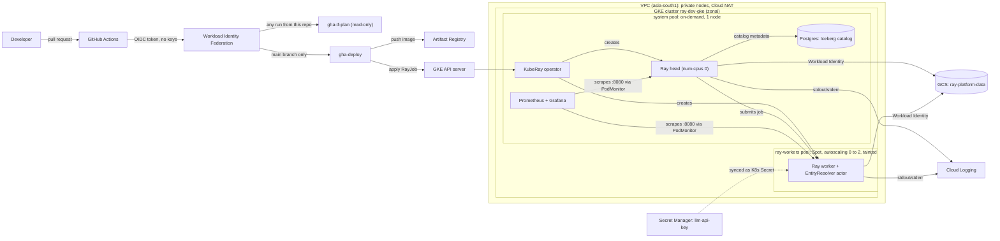

# Ray AI Platform on GKE: "The Distributed AI Foundation"

A production-like platform for running a scheduled Ray pipeline on Kubernetes (GKE). A nightly-style job ingests two corporate datasets, resolves duplicate companies (entity resolution), upserts the harmonized result into an Apache Iceberg table transactionally, and trains a model that predicts annual revenue.

Everything is infrastructure as code (Terraform, in decoupled state layers), keyless (Workload Identity for pods, Workload Identity Federation for CI), and delivered through GitHub Actions.

Repository: https://github.com/Sneghapriya/contexq-ray-platform

## Contents

1. [Architecture](#1-architecture)
2. [Repository layout](#2-repository-layout)
3. [The pipeline](#3-the-pipeline)
4. [Setup and runbook](#4-setup-and-runbook)
5. [Terraform design](#5-terraform-design)
6. [Spot instance strategy](#6-spot-instance-strategy)
7. [Ray Data and Ray Train configuration](#7-ray-data-and-ray-train-configuration)
8. [Scheduling the EntityResolver](#8-scheduling-the-entityresolver)
9. [Security and zero trust](#9-security-and-zero-trust)
10. [Iceberg catalog](#10-iceberg-catalog)
11. [CI/CD](#11-cicd)
12. [Observability](#12-observability)
13. [Failure handling](#13-failure-handling)
14. [Serverless alternative](#14-serverless-alternative)
15. [Known limitations and next steps](#15-known-limitations-and-next-steps)

---

## 1. Architecture



**Flow of one run:** a merge to `main` builds the image and pushes it to Artifact Registry. The workflow then applies a `RayJob`. The KubeRay operator creates a head pod (on the stable pool) and a worker pod (on the Spot pool, which scales up from zero). The driver reads the CSVs from GCS with Ray Data, the `EntityResolver` actor runs on the worker, the result is upserted into the Iceberg table (metadata in Postgres, data files in GCS), and the pods are cleaned up when the job finishes.

## 2. Repository layout

```
.
├── .github/workflows/
│   ├── terraform-plan.yaml        # fmt, validate, plan on every pull request
│   └── build-and-deploy.yaml      # on merge: build image, run RayJob, wait for result
├── app/
│   ├── generate_data.py           # synthetic dataset generator
│   └── ray_pipeline.py            # the Ray pipeline
├── data/                          # generated CSVs (also uploaded to GCS)
├── k8s/
│   ├── rayjob.yaml                # RayJob (head, Spot worker group, shm, env)
│   ├── iceberg/postgres.yaml      # Iceberg catalog database (StatefulSet)
│   └── monitoring/ray-podmonitor.yaml
├── scripts/env.sh                 # exports project, image and job variables
├── terraform/
│   ├── modules/
│   │   ├── network/               # VPC, subnet, Cloud Router + NAT
│   │   ├── gke-cluster/           # private GKE, system pool, Spot worker pool
│   │   ├── kuberay/               # namespace + KubeRay operator (Helm)
│   │   ├── workload-identity/     # Google SA, K8s SA, bindings, bucket access
│   │   └── monitoring/            # kube-prometheus-stack (Helm)
│   └── environments/dev/          # one state per layer, applied in order
│       ├── 00-bootstrap/          # data bucket, image registry, CI identities
│       ├── 01-network/
│       ├── 02-cluster/
│       └── 03-platform/           # KubeRay, identity, secrets, monitoring
├── Dockerfile
├── requirements.txt
└── README.md
```

## 3. The pipeline

`app/ray_pipeline.py`, packaged with its dependencies in the container image.

| Step | What happens |
|---|---|
| Ingest | `ray.data.read_csv` reads two source files (`supply_chain_s1.csv`, `financial_s2.csv`, 1,100 rows each) from `gs://ray-platform-data/data`. |
| Entity resolution | The `EntityResolver` actor normalizes company names (case, punctuation, legal suffixes), blocks candidates by first letter, scores them with fuzzy matching, and assigns matches **one-to-one** so two source records can never claim the same company. |
| Harmonize | Records with the same `canonical_id` are merged. |
| Train | A gradient-boosted regressor predicts annual revenue (on a log scale, because revenue is heavily skewed). `total_assets` is excluded on purpose: it is derived from revenue (data leakage). |
| Sink | Upsert into Iceberg table `corporate.corporate_registry`, keyed on `canonical_id`, as one atomic commit. |

**Synthetic data.** `app/generate_data.py` (seeded, reproducible) creates the same companies in both files with deliberately different spellings (legal suffix variants, casing, commas, occasional dropped letters). A hidden `ground_truth.csv` answer key lets the job measure its own matching quality. It is evaluation data only and never used for matching.

**Observed results** (same numbers locally, in the container and on the cluster):

| Metric | Value |
|---|---|
| Resolver precision | 0.996 |
| True matches found | 929 of 933 |
| Revenue model R2 (log scale, held-out) | 0.980 |
| Second run on the same data | `Upsert committed: 0 inserted, 0 updated` (idempotent) |

The LLM-based resolution is represented by fuzzy matching. The actor already receives `LLM_API_KEY` securely; in production the LLM call would handle the hard cases the fuzzy matcher scores below the threshold.

## 4. Setup and runbook

### Prerequisites

`gcloud` (with `gke-gcloud-auth-plugin`), `terraform` >= 1.5, `kubectl`, `docker`, `envsubst`, and a GCP project with billing enabled. The commands below assume region `asia-south1`, zone `asia-south1-a`.

### One-time setup

```bash
gcloud auth login
gcloud auth application-default login          # Terraform credentials
gcloud config set project <PROJECT_ID>

gcloud services enable container.googleapis.com compute.googleapis.com \
  artifactregistry.googleapis.com iam.googleapis.com iamcredentials.googleapis.com \
  secretmanager.googleapis.com cloudresourcemanager.googleapis.com sts.googleapis.com

# Terraform state bucket (created by hand: Terraform cannot create its own state store)
gcloud storage buckets create gs://<STATE_BUCKET> --location=asia-south1 --uniform-bucket-level-access
gcloud storage buckets update gs://<STATE_BUCKET> --versioning
```

Set your values in each layer's `terraform.tfvars` (region, names, `state_bucket`, `github_repo`, and so on). The project ID is not stored in Git; it is passed as `TF_VAR_project_id`. `scripts/env.sh` sets the project, image and job variables for a terminal:

```bash
source scripts/env.sh
```

### Apply the layers, in order

```bash
cd terraform/environments/dev
for layer in 00-bootstrap 01-network 02-cluster 03-platform; do
  (cd $layer && terraform init -backend-config="bucket=<STATE_BUCKET>" && terraform apply)
done
```

`00-bootstrap` also creates the GitHub identities. The deploy identity is bound to the exact OIDC subject GitHub sends. That subject contains GitHub's numeric owner and repository IDs (`repo:<owner>@<id>/<repo>@<id>:ref:refs/heads/main`), set through `github_deploy_subject` in tfvars. Read the IDs from the repository API or from a debug run of the workflow.

### Steps that Terraform does not cover

```bash
# 1. Cluster credentials (the endpoint changes every time the cluster is rebuilt)
gcloud container clusters get-credentials ray-dev-gke --zone asia-south1-a --project $PROJECT_ID

# 2. Data
gcloud storage cp data/*.csv gs://<DATA_BUCKET>/data/

# 3. LLM key: the Secret Manager entry is created by Terraform; its value is added by hand
printf '<value>' | gcloud secrets versions add llm-api-key --data-file=-
kubectl create secret generic llm-api-key -n ray \
  --from-literal=LLM_API_KEY="$(gcloud secrets versions access latest --secret=llm-api-key)" \
  --dry-run=client -o yaml | kubectl apply -f -

# 4. Iceberg catalog database and metrics scraping
kubectl apply -f k8s/iceberg/postgres.yaml
kubectl rollout status statefulset/iceberg-catalog -n ray --timeout=180s
kubectl apply -f k8s/monitoring/ray-podmonitor.yaml
```

Add these GitHub repository **variables** (names and emails only, no secrets): `WIF_PROVIDER`, `PLAN_SA`, `DEPLOY_SA`, `PROJECT_ID`, `STATE_BUCKET`. All five come from `terraform output` in `00-bootstrap` or from your project.

### Run the pipeline

Through CI: merge to `main` (or **Actions, then build-and-deploy, then Run workflow**).

By hand:

```bash
source scripts/env.sh
: "${IMAGE:?set IMAGE}" "${JOB_NAME:?set JOB_NAME}"
envsubst '${IMAGE} ${JOB_NAME}' < k8s/rayjob.yaml | kubectl apply -f -
kubectl get rayjob -n ray -w
```

A successful run ends with `SUCCEEDED`. The first run on an empty catalog logs `Created table`; later runs log `Upsert committed`.

### Teardown (compute is destroyed between sessions)

```bash
kubectl delete rayjob --all -n ray
kubectl delete -f k8s/iceberg/postgres.yaml
kubectl delete pvc --all -n ray                    # persistent disks outlive the cluster
gcloud storage rm -r gs://<DATA_BUCKET>/warehouse  # the catalog dies with the cluster
(cd terraform/environments/dev/03-platform && terraform destroy)
(cd terraform/environments/dev/02-cluster && terraform destroy)
gcloud compute disks list                          # should be empty
```

`00-bootstrap` (bucket, registry, identities), `01-network` and the state bucket are kept.

## 5. Terraform design

**Layers with separate state.** Each layer is its own root module with its own state prefix in a versioned GCS bucket, and later layers read earlier layers' outputs through `terraform_remote_state`.

| Layer | Contents | Lifecycle |
|---|---|---|
| `00-bootstrap` | Data bucket, Artifact Registry, GitHub OIDC pool and CI service accounts | Long-lived, cheap |
| `01-network` | VPC, subnet with pod and service ranges, Cloud Router and NAT | Long-lived, nearly free |
| `02-cluster` | Private GKE cluster, node service account, system pool, Spot worker pool | Expensive, destroyed between sessions |
| `03-platform` | KubeRay operator, Ray namespace, Workload Identity, secrets, monitoring stack | Destroyed with the cluster |

Why layers: the compute can be torn down daily without any risk to the data or the registry, a mistake in one layer cannot touch another, and each layer has a small, reviewable plan.

**Modules** hold reusable logic (`network`, `gke-cluster`, `kuberay`, `workload-identity`, `monitoring`). Environments differ only by their `terraform.tfvars`; variables have no defaults, so every value an environment uses is visible in one file. The only value kept out of Git is the project ID.

**Cluster properties:** zonal cluster (a regional one would triple the node count), private nodes behind Cloud NAT, shielded nodes, release channel `REGULAR`, Workload Identity enabled, and a dedicated least-privilege node service account (logging, monitoring and registry read only) instead of the default compute account.

**Node pools**

| Pool | Machine | Capacity | Purpose |
|---|---|---|---|
| `system` | e2-standard-4 | 1 node, on-demand | Ray head, KubeRay operator, Postgres catalog, Prometheus and Grafana |
| `ray-workers` | e2-standard-4 | Spot, autoscaling 0 to 2, label `pool=ray-worker`, taint `ray-worker=true:NoSchedule` | Ray workers and the EntityResolver actor |

## 6. Spot instance strategy

Workers run on **Spot VMs** (typically a large discount compared with on-demand) and the pool **scales to zero** when idle, so compute is billed only while a job runs. Interruptions are expected, so resilience is built into each layer:

| Layer | Mechanism |
|---|---|
| Placement | Only workers run on Spot. The head, operator, catalog database and monitoring are on the on-demand system pool, so the coordinator is never reclaimed with the workers. The taint keeps everything else off Spot nodes. |
| Job level | `RayJob` has `backoffLimit: 2`. If a reclaimed node fails the job, KubeRay retries it. |
| Capacity | The autoscaler replaces a reclaimed node when a worker pod is pending. |
| Correctness | Writes are **idempotent**: the Iceberg upsert is keyed on `canonical_id` and committed atomically. A re-run cannot duplicate or corrupt data (a second run reports 0 inserted, 0 updated). Partial output is never visible, because the table only changes at commit. |
| Training | Training state would be checkpointed to GCS (see section 7) so a reclaimed node resumes instead of restarting. |
| Cost control | The worker pool scales to zero when idle, and the compute layers are destroyed between sessions. Prometheus keeps only 24 hours of metrics and uses no persistent disk. |

Trade-off: an interruption costs time (a re-run of a few minutes for this dataset), not correctness.

## 7. Ray Data and Ray Train configuration

The pipeline currently trains with scikit-learn. The settings below are what the cluster is configured for and what would be used for Ray Train. Items marked "design" are not exercised by the current pipeline; verify exact API names against the pinned Ray version (2.59.0).

**Shared memory and the object store (implemented in `k8s/rayjob.yaml`)**

- Ray's object store lives in shared memory. Containers get a small `/dev/shm` by default, which causes spilling to disk or failures on large datasets. Each Ray pod mounts a **memory-backed `emptyDir` at `/dev/shm`**, sized to hold the object store (2 GiB on workers, 1 GiB on the head in this demo).
- `object-store-memory` is set explicitly on workers (1 GiB here) so it is smaller than the shm volume and the pod memory limit. As a guideline, about 30% of a node's memory is a good starting point, and the pod's memory request equals its limit so the scheduler reserves what Ray is allowed to use.
- The head runs with `num-cpus: 0`, so it only coordinates and all tasks and actors land on workers. That also keeps work off the on-demand node.
- `metrics-export-port: 8080` is set on every node so Prometheus can scrape it.

**Ray Data for high-throughput ingestion**

- Read from object storage in parallel (`ray.data.read_csv` or `read_parquet` on `gs://` paths). For large inputs use columnar formats (Parquet) and many files, and set read parallelism (`override_num_blocks`) to at least the total worker CPU count so every core has work.
- Keep blocks in a healthy range (tens to a few hundred MB) so tasks are large enough to amortize overhead and small enough to fit in the object store.
- Size the cluster so the working set fits in the aggregate object store; otherwise Ray spills to local disk, so use a node pool with enough disk for the spill directory.
- Workers scale out through the autoscaler. With more workers, ingestion throughput scales close to linearly until network or storage limits.

**Ray Train for distributed training (design)**

- Replace the scikit-learn step with an XGBoost or PyTorch trainer, driven by `ScalingConfig(num_workers=N, use_gpu=<bool>, resources_per_worker={...})`.
- Write checkpoints and results to `gs://.../checkpoints` through `RunConfig(storage_path=...)`, and set `FailureConfig(max_failures=3)` so a reclaimed Spot node resumes from the last checkpoint.
- Keep training workers on a dedicated worker group (and a GPU pool when GPUs are available), while the head stays on the system pool.
- Pass the harmonized Ray Dataset straight into the trainer so data is streamed to workers without going through the driver.

## 8. Scheduling the EntityResolver

The actor is placed on the worker group using three cooperating mechanisms:

1. **Kubernetes placement.** The worker pod spec has `nodeSelector: pool=ray-worker` and a toleration for the pool taint, so worker pods can only run on the Spot node group.
2. **Ray custom resource.** The worker group starts Ray with `resources: '{"resolver": 1}'`. The head and the system pool advertise no such resource.
3. **Actor request.** The driver creates the actor with `EntityResolver.options(resources={"resolver": 1}).remote()`. Ray will only schedule it on a node that advertises `resolver`, so it can never land on the head. This is enabled with `PIN_RESOLVER=true` in the RayJob (it is off for local runs).

Result: the stateful resolver runs on the worker group, verified in the Ray Dashboard (Actors tab shows the actor on the worker node) and in the logs, where the actor's IP is a worker pod IP. To move the actor to GPUs later, add a GPU node pool, tag its Ray group with the same custom resource, and set `num_gpus=1` on the actor.

## 9. Security and zero trust

| Area | Approach |
|---|---|
| Pod to cloud | **Workload Identity.** Pods run as Kubernetes service account `ray-sa`, bound to Google service account `ray-workload`, which has object access on the data bucket only. No key files exist anywhere. Tokens are short-lived and rotate automatically. |
| CI to cloud | **Workload Identity Federation** with GitHub OIDC. No service account keys are stored in GitHub. The provider only accepts tokens from this repository. |
| CI least privilege | Two identities: `gha-tf-plan` is read-only (usable by any run from this repo, including pull requests); `gha-deploy` can push images and manage Ray jobs and is bound to the exact subject of runs from `main`, so a pull request cannot deploy. |
| Network | Private nodes (no public IPs) behind Cloud NAT, private Google access, VPC-native networking. |
| Secrets | `LLM_API_KEY` lives in Secret Manager, readable only by the Ray identity, synced into a Kubernetes Secret and injected as an environment variable. The Postgres catalog password is generated by Terraform (`random_password`) and stored only in a Kubernetes Secret. Neither is in Git, the image or the manifests. |
| Nodes | Dedicated least-privilege node service account, shielded nodes, bucket public access prevention enforced. |
| Operator placement | The KubeRay operator is pinned to the stable pool. |

## 10. Iceberg catalog

- **Catalog:** a PyIceberg SQL catalog backed by a small **Postgres StatefulSet** (`k8s/iceberg/postgres.yaml`, on the system pool, 2 Gi persistent volume). It stores table metadata pointers.
- **Warehouse:** `gs://ray-platform-data/warehouse`, accessed through Workload Identity.
- **Table:** `corporate.corporate_registry`, updated with `upsert` keyed on `canonical_id`, which is one atomic commit.
- **Config** reaches the job through environment variables (`ICEBERG_WAREHOUSE`, `CATALOG_HOST`, and credentials from a Kubernetes Secret), so the same code also runs locally against a SQLite catalog and a local folder.

For production, the in-cluster Postgres would be replaced by a managed catalog (Cloud SQL, or a REST catalog service). It is in-cluster here to keep the demo self-contained and cheap.

## 11. CI/CD

**`terraform-plan.yaml`** runs on **every pull request**: `terraform fmt -check`, then for each of `00-bootstrap`, `01-network` and `02-cluster` (in a matrix) `init`, `validate` and `plan`. The plan summary is shown on the run. It authenticates as the read-only identity, with no keys. `03-platform` is planned manually, because planning it needs a live cluster to connect to.

**`build-and-deploy.yaml`** runs on merge to `main` (when the app, Dockerfile, requirements or RayJob manifest change) and can also be started by hand:

1. Authenticate as `gha-deploy` through Workload Identity Federation.
2. Build the Docker image containing `ray_pipeline.py` and its dependencies, tag it with the commit SHA, and push it to Artifact Registry.
3. Remove earlier pipeline RayJobs and submit a new one with a unique name and the new image.
4. Poll until the job reaches `SUCCEEDED` (fail fast on `FAILED`) and print the log tail.

Only one deploy runs at a time (`concurrency` group). Terraform **applies are manual and in layer order** by design. In production they would move into an approval-gated workflow (GitHub Environment with required reviewers and a separate apply identity), and pull requests would be mandatory on `main`.

Screenshots: `docs/screenshots/` contains the green plan checks, a plan summary, and a green deploy run.

## 12. Observability

| Need | Implementation |
|---|---|
| **Metrics** | `kube-prometheus-stack` is installed by Terraform (light resource footprint, 24 h retention). A `PodMonitor` (`k8s/monitoring/ray-podmonitor.yaml`) scrapes port 8080 on every Ray head and worker pod. Node, pod and Ray task, CPU and object store metrics are available in Prometheus and Grafana. |
| **Dashboard** | The Ray Dashboard (jobs, actors, cluster) is reached with `kubectl port-forward svc/<raycluster>-head-svc 8265:8265`. It is not exposed publicly because it has no authentication. Port-forward authenticates through the Kubernetes API (Google identity and RBAC). |
| **Logs** | GKE ships stdout and stderr from every pod to **Cloud Logging**, so logs survive the pods. A saved query filters the Ray head and worker logs: `resource.type="k8s_container" resource.labels.cluster_name="ray-dev-gke" resource.labels.namespace_name="ray" resource.labels.pod_name:"entity-resolution"`. |

Access for Prometheus and Grafana is also through port-forward. In production, Grafana and the Ray Dashboard would sit behind an Ingress or Gateway with a managed TLS certificate and Identity-Aware Proxy (or an OAuth proxy with company SSO), DNS managed automatically, and Prometheus kept cluster-internal.

## 13. Failure handling

| Failure | What happens |
|---|---|
| Spot worker reclaimed mid-job | The job attempt fails; `backoffLimit` retries; the autoscaler provides a new Spot node; the idempotent upsert makes the retry safe. |
| Head pod lost | The attempt fails and is retried as above. The head is on the on-demand pool and is never part of Spot reclamation. Single-head GCS fault tolerance is a known limitation (section 15). |
| Catalog database lost (cluster rebuilt) | Table files remain in GCS, but the catalog pointing to them is gone. The runbook clears the warehouse prefix before a fresh run. A managed catalog removes this limitation. |
| Duplicate match in resolution | Prevented by one-to-one assignment, and a defensive de-duplication on the key before the write. A duplicate key would otherwise make the upsert fail. |
| Bad deploy credentials or a PR trying to deploy | The deploy identity trusts only runs from `main`; anything else is refused by Google. |
| Wrong or empty image variable in a manifest | Guard lines in the runbook and the workflow fail with a clear message instead of submitting an invalid pod. |
| Job hangs | The workflow has a bounded wait and a job timeout. |

## 14. Serverless alternative

For a modest scheduled pipeline, the Kubernetes cluster can be removed entirely:

| Today (GKE) | Serverless version |
|---|---|
| RayJob on GKE | The same container as a **Cloud Run job** (parallel task instances), or **Dataflow** if the data grows beyond what a job's CPU and memory limits allow |
| Ray head, Spot workers, autoscaler | Managed scaling, scale to zero, nothing to patch or size |
| In-cluster Postgres catalog | A managed or REST Iceberg catalog, with tables on the same GCS bucket |
| KubeRay, node pools, taints | Not needed |
| Prometheus, Grafana | Cloud Monitoring and Cloud Logging, built in |
| Workload Identity | A service account attached to the job (the same keyless idea) |
| GitHub Actions applies a RayJob | GitHub Actions deploys the job; Cloud Scheduler triggers it |

**Benefits:** no cluster to operate, no idle cost, far less to secure and upgrade.

**Costs:** no Ray actor model or custom-resource scheduling, so the stateful resolver would become a separate service; no Ray Train, so distributed training moves to a managed training service (Vertex AI); less control over memory, shared memory and placement; and run-time and resource limits per job.

**Choice:** serverless for a modest nightly batch with a small team. Kubernetes with Ray when the team wants distributed Python, GPU training and LLM serving on one flexible platform, which is what this assignment builds.

## 15. Known limitations and next steps

- **Single Ray head, no GCS fault tolerance.** Production would enable Ray head fault tolerance with an external Redis.
- **Training uses scikit-learn.** Ray Train is described (section 7) but not implemented; converting the step to an XGBoost trainer with GCS checkpoints is the natural next step.
- **Entity resolution uses fuzzy matching.** The LLM call, using the securely injected key, would handle low-confidence pairs.
- **In-cluster Postgres catalog** (not durable across cluster rebuilds); production would use a managed catalog.
- **Development shortcuts:** the GKE API server is open to all networks (`0.0.0.0/0`) so the cloud workspace and CI can reach it, and the demo cluster is zonal. Production would restrict authorized networks or use a bastion or connect gateway, and run regional.
- **Terraform applies are manual.** Next step: an approval-gated apply workflow with a dedicated apply identity, mandatory pull requests on `main`, and a scheduled plan to detect drift.
- **Monitoring access** is through port-forward; production would use Ingress with TLS and IAP.
- **Ray log files inside pods** (beyond stdout and stderr) are lost with the pod; a log-forwarding sidecar would capture them.
- **The deploy workflow needs a running cluster,** which here exists only during working sessions; production would have a permanent cluster.